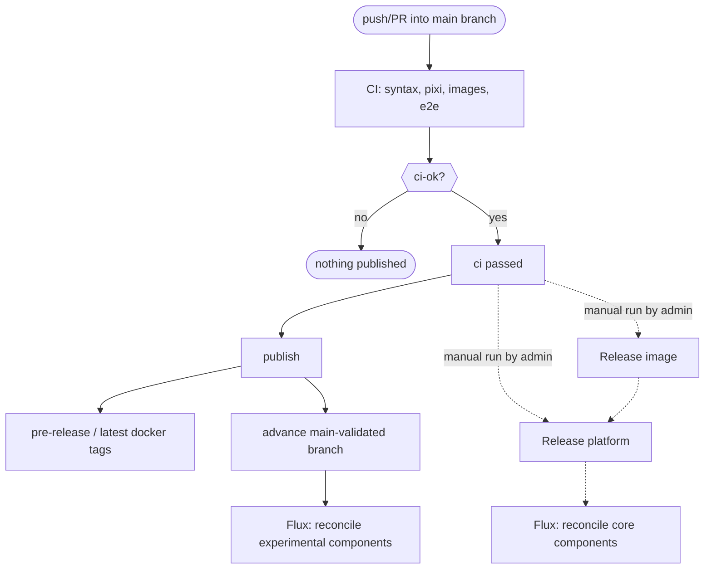

# Releasing

Two version streams are minted by hand, one automatically; everything else is
CI-owned. Never create a version tag or move a channel tag by hand.

| Stream                                         | Scheme                                     | Minted by                                                | Reaches the cluster                                                                                                    |
| ---------------------------------------------- | ------------------------------------------ | -------------------------------------------------------- | ---------------------------------------------------------------------------------------------------------------------- |
| **Platform** (the core Flux root)              | CalVer `YYYY.M.SEQ` (`2026.7.8`)           | **Release platform** workflow                            | next core Flux reconcile (~1 min)                                                                                      |
| geddes2 core root                              | tracks `main` itself                       | a push to `main`, with no CI gate                        | geddes2 Flux reconcile (~1 min)                                                                                        |
| **purdue-af image** (Dockerfile, `pixi/base`)  | semver `v0.X.Y` (`v0.13.0`)                | **Release image** workflow                               | default profile at the next platform release; the pre-release profile pulls `:pre-release` on every spawn             |
| **agentic-interface image**                    | semver `agentic-interface-vX.Y.Z`          | `ci.yml` publish stage — **automatic**                   | same pipeline — experimental Flux reconcile (~1 min); its Deployment pins the released tag, never `:latest`            |
| Experimental Flux source (`main-validated`)    | moving branch                              | `ci.yml` publish stage, behind `ci-ok`                   | experimental Flux reconcile (~1 min)                                                                                   |
| Continuous (`:latest`, `:pre-release`, `sha-`) | moving tags                                | `ci.yml` publish stage, behind `ci-ok`                   | on pod restart / session spawn                                                                                         |
| `:latest`-only images                          | `:latest`                                  | `ci.yml` publish stage, behind `ci-ok` — no release step | af-pod-monitor at the next spawn; af-node-monitor, supersonic-model-manager, agentic-analysis and ray-nrp on pod restart; a node keeps the af-node-monitor it first pulled |
| interLink plugin images                        | upstream ref `:$PLUGIN_REF`                | a `PLUGIN_REF` bump                                      | when the interLink values pin the new ref ([slurm](docker/interlink-slurm-plugin/README.md), [kubernetes](docker/interlink-kubernetes-plugin/README.md)) |
| Global env (`pixi/global`)                     | the CI-owned lock                          | CI validates the lock                                    | `pixi-global-sync` applies it to `/work/pixi/global`                                                                   |
| Upstream sources                               | branches and moving tags outside this repo | upstream commits                                         | next reconcile or pod restart, with no commit here: krab's chart and code location image, servicex-eos's fork chart and its `:local` images. No rollback below applies |

Every commit runs one pipeline ([ci.yml](.github/workflows/ci.yml)) and
nothing is published unless every stage passed for that exact commit. The
publish stage runs on `main` only; the two releases are `workflow_dispatch`
runs from the Actions tab.

A delivery that fails leaves the workloads running as they were, and the status
badges read git, not the cluster. `AFFluxRootNotReady` and
`AFHelmReleaseNotReady` report it, and
`kubectl -n cms get gitrepositories,kustomizations,helmreleases` shows the cause
in its READY and SUSPENDED columns.



## Platform release

Mint one whenever core components need to reach the cluster: hub
configuration, monitoring, cronjobs, manifest changes. (Experimental
components track `main-validated` and never need one.)

**Actions → Release platform → Run workflow** computes the next
`YYYY.M.SEQ`, tags it, and publishes a GitHub Release with generated notes —
no file edits, no image tags. Core Flux advances within ~1 minute. It refuses
a commit whose `ci-ok` has not passed, a running pipeline included, unless
`force` is set; a Release image commit has no pipeline and passes on its
parent's gate.

**Rollback**: delete the newest Release _together with its tag_. Flux tracks
the newest platform **git tag**, so it re-resolves to the previous one and
re-applies that commit on the next reconcile.

```
gh release delete 2026.7.9 --cleanup-tag   # --cleanup-tag is what matters
```

Deleting the Release object alone rolls back **nothing**. And this rolls back
what is deployed, not history: `main` still contains the offending commits —
fix or revert them, or the next tag re-ships them.

## purdue-af image release

Release when the content soaking as `:pre-release` should become the default
session environment. **major** — never, until the AF moves from R&D to
Operations; **minor** — breaking changes for users, or a major change to the
codebase; **patch** — anything else.

Preconditions, enforced by the workflow (bypass only with `force`): `ci-ok`
green on main HEAD, and the `:pre-release` digest identical to the image of
the current repo state. Complete the manual checklist in
[docker/purdue-af/README.md](docker/purdue-af/README.md) first.

1. **Actions → Release image → Run workflow** — choose the bump (or an
   explicit `version`). It adds the semver tag to the **same digest** that
   passed CI (never a rebuild), rewrites every version spot in the hub's
   values.yaml and the pixi-global-sync image (`bump-af-version.py`,
   count-verified), commits to `main`, tags `v<version>`, and publishes a
   Release.
2. **Actions → Release platform → Run workflow** — always the second step:
   the bump commit reaches the hub only once a platform tag covers it.
   pixi-global-sync is experimental and takes it at the next `main-validated`
   advance.

**Rollback**: `git revert` the release commit on `main`, then mint a new
platform tag. Never delete a `v*` tag — the pin lives in a values.yaml
commit, so deleting the tag rolls back nothing. Old semver tags stay on ghcr
forever; the registry GC never deletes release tags.

## agentic-interface image auto-release

No button, no token. The publish stage of every green `main` pipeline checks
whether the digest it just validated (`in-<hash>` of the tested tree) is what
[apps/agentic-interface/deployment.yaml](apps/agentic-interface/deployment.yaml)
pins. If not, it mints the next version: promotes that exact digest to a bare
`X.Y.Z` tag on ghcr (never a rebuild), rewrites the Deployment pin
(`bump-agentic-version.py`, count-verified), pushes an `auto-release` commit
to `main`, tags `agentic-interface-v<version>`, and advances `main-validated`
to the bump commit in the same run — experimental Flux rolls the pod onto the
released tag about a minute later. Merge → deployed version in one pipeline,
with no human step.

The bump kind is chosen automatically: **minor** when the skill
(`.claude/skills/purdue-af-agentic-interface` — the user-facing contract of
the MCP server, and an input of the image hash) changed since the last
release, **patch** otherwise. So a skill-only change still mints and deploys a
new version, and the version number tells users whether their side of the
interface moved. The skill states the MAJOR.MINOR it ships in (its `Skill
version:` line); the checks stage fails, naming the value to set, until that
stamp matches the bump, and the server announces it so an agent can tell its
user how far behind their copy is. Major versions are never minted
automatically; if one is ever wanted, `--set` it by hand in a normal commit
and let CI validate it.

The bump commit is the ONE deliberate exception to "everything on
`main-validated` ran its own pipeline": it is pushed with `GITHUB_TOKEN`
(which triggers no workflows), so instead it is
validated in-run — the step proves the commit differs from the tree this
pipeline just validated by exactly the one rewritten image-tag line, refuses
to release if `main` moved during the run, and stamps a `ci-ok` check run on
the bump commit via the API (annotated with the validating run) so the
purdue-af release gate keeps working. The bump commit changes only the
Deployment (not an image input), so the next pipeline sees digest == pin and
no-ops — the cycle terminates after one bump.

Note the deploy is `strategy: Recreate` (stateful in-process MCP sessions),
so each auto-release drops in-flight MCP sessions for a few seconds.

**Rollback**: `git revert` the CODE commit that produced the bad image — not
the auto-release commit (the digest check would just re-bump onto the same
bad image). The reverted tree hashes back to the previous good image, and the
next pipeline auto-releases a new patch version pointing at those good bytes.
Never delete an `agentic-interface-v*` tag.

## Rules of the road

- Channel tags (`:latest`, `:pre-release`), `sha-` provenance tags and
  `main-validated` move only in the `ci.yml` publish stage, after every stage
  of the same commit is green. `in-<hash>` tags name build content, not a
  validated state: the images stage pushes them as soon as an image builds,
  on same-repo PRs too ([docker/REGISTRY.md](docker/REGISTRY.md)). The
  `protect-main-validated` ruleset blocks deleting the branch and leaves
  updates open, so `GITHUB_TOKEN` can push it. Publish moves it forward only:
  a re-run of a commit behind it fails, and after a history rewrite publish
  refuses until the branch is moved by its owner.
- Workflows push with `GITHUB_TOKEN`, whose pushes trigger no workflow:
  - the **Release image** commit gets no CI run and no `ci-ok`. Gate 1 of the
    next image release fails until another commit lands on `main` and passes
    CI, or `force` is used. The platform tag of step 2 points at that commit,
    which CI has not run on.
  - a lock commit from `ci-pixi-base.yml` / `ci-pixi-global.yml` gets its
    follow-up run from `retrigger-after-lock-push.sh`: an approved
    `pull_request` run, or else a `workflow_dispatch` run, which never
    publishes.
  - **Release platform** is unaffected: it pushes only a tag, and no
    workflow triggers on tags.
