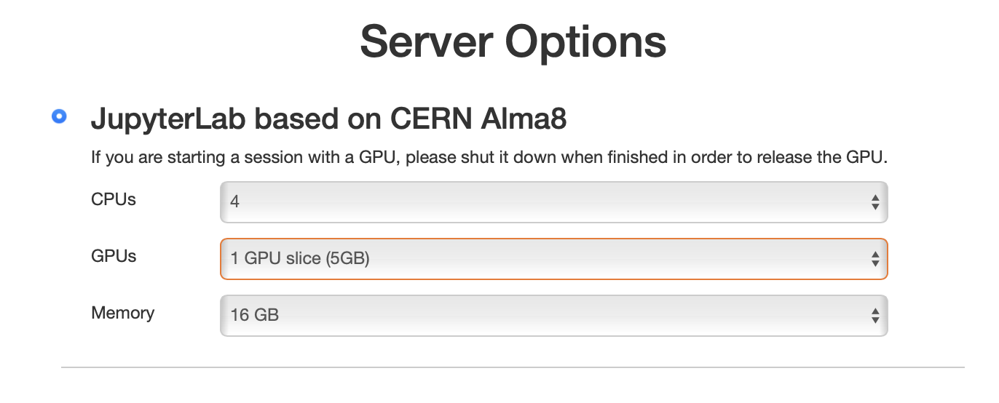

# GPUs in a session

You can start a session with an **Nvidia A100** or **Nvidia T4** GPU by
selecting it at the resource selection step. For A100s you can choose either a
5 GB "slice" or a full 40 GB GPU. To train on several GPUs, or on a GPU from a
session without one, use [Ray](guide-ray-train.md); for GPU batch jobs, use
[Slurm](scaling-out.md#slurm-purdue-users-only). The GPUs installed at the
facility are listed in [Hardware](hardware.md).

<figure markdown="span">
  { width="500" }
</figure>

| Configuration        | Memory | Availability |
| -------------------- | ------ | ------------ |
| 5 GB "slice" of A100 | 5 GB   | Usually immediate |
| Full A100 GPU        | 40 GB  | Subject to availability |
| NVIDIA T4            | 16 GB  | Usually immediate |

The resource selection form shows how many GPUs of each kind are free right now.

!!! important

    Please terminate your session after using a GPU in order to release it for
    other users. Idle GPU sessions are shut down sooner than regular ones — see
    [Idle sessions](scaling-out.md#idle-sessions).

## CUDA

Each environment brings its own CUDA and cuDNN libraries, so install ML packages
into the environment that uses them. Install CUDA 12 builds: the GPU nodes'
driver runs no CUDA 13 (`nvidia-smi` shows its limit). `nvcc --version` shows
the session's CUDA toolkit, which matters only when you compile CUDA code.

## GPU support in common libraries

* **PyTorch** — already GPU-enabled in the [global Pixi environment](software.md).
  In your own environment, install a CUDA 12 build.
  See the [PyTorch CUDA semantics documentation](https://pytorch.org/docs/stable/notes/cuda.html).
* **XGBoost** — enable GPU support by setting the `device` parameter to `cuda`.
  Refer to the
  [XGBoost GPU documentation](https://xgboost.readthedocs.io/en/stable/gpu/index.html)
  for details.
* **RooFit** — fits can run on a GPU; see
  [RooFit on GPUs](guide-roofit-cuda.md).

You can verify that your session sees the GPU with `nvidia-smi`, or from Python:

```python
import torch

print(torch.cuda.is_available())
print(torch.cuda.get_device_name())
```

If you experience any issues, or are missing any ML libraries, please
[contact Purdue AF support](support.md).
